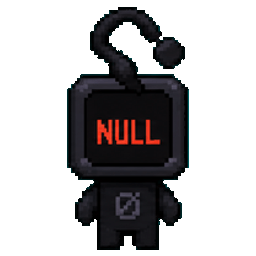
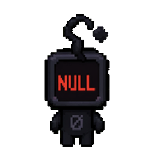

<div align="center">



# Codex Discord RPC

**Your AI coding companion, live on Discord.**

Animated pets · Live activity · Model & effort · Project & Git changes

[](https://nodejs.org/)
[](LICENSE)
[](#privacy)

[Install](#install-once) · [What appears](#what-appears) · [Commands](#commands) · [Compatibility](#compatibility) · [Privacy](#privacy)

</div>

## Install once

You need **Node.js 22.18+** and the **Discord desktop app** on the same computer as Codex.

```sh
npx --yes github:xD-Mohamed/codex-discord-rpc install
```

That's it. The tool starts in the background now and automatically at your next login. Use Codex normally; the activity follows your work. No Application ID, account token, API key or per-project setup.

> **بالعربي:** شغّل الأمر مرة واحدة. بعد كده الأداة بتشتغل تلقائيًا في الخلفية وتعرض نشاط Codex على Discord. مش لازم تفعّل الـpet داخل Codex.

This is currently distributed through GitHub. The shorter `npx codex-discord-rpc` command is not available until an npm registry release is published.

Want to try it without installing automatic startup?

```sh
npx --yes github:xD-Mohamed/codex-discord-rpc
```

Keep that terminal open; press **Ctrl+C** to stop.

## What appears

```text
ChatGPT Codex
Thinking · GPT-6 Astra · Ultra
Project: My App  |  +400 −50
⏱ Elapsed time
```

- **Activity:** thinking, planning, editing, reading, reviewing, searching, testing, running commands, organizing context, creating artwork, waiting, idle or needs attention.
- **Model and reasoning effort:** read from the actual session when available.
- **Project:** only the directory's final name. Generated projectless chat folder names are hidden.
- **Git:** staged + unstaged tracked changes against HEAD. Counts refresh at most every 10 seconds. After committing, `Git clean` replaces `+0 −0`. Untracked and binary files are not counted; unavailable totals are omitted.
- **Companion:** the selected built-in pet, the last remembered pet when disabled, or the default Codex pet. No need to enable pets in Codex.
- **ChatGPT badge:** a small white ChatGPT mark on a fully transparent background appears in the lower-right corner of the companion image.

Two projects running? The first active project keeps the card until it finishes. Then the next takes over. **No cycling between projects.** Real projects take priority over projectless chats, including when a project starts a follow-up task. A second publisher cannot compete with the first.

Finished working but left Codex open? The card stays visible as **Idle**, with the idle pet animation and the last observed project/model where available. It switches back when work resumes and clears when the supported Codex app/backend processes close. A cold start without recent task metadata shows a generic Idle card. Process checks read executable paths only, never arguments or window titles; a generic VS Code window alone does not imply that its Codex extension is running.

Discord controls the card's fonts and layout. The name cannot be moved into the Playing heading or made larger through Rich Presence. The registered application is named **Codex AI**; the activity requests **ChatGPT Codex** through Discord's activity-name field, subject to client support.

## A companion for every state

Original Codex animation frames with **native application timing**. No artificial speed-up or half-speed slowdown.

|                             Thinking / reviewing                             |                              Editing / working                               |                               Waiting for you                                |                                   Finished                                   |
| :--------------------------------------------------------------------------: | :--------------------------------------------------------------------------: | :--------------------------------------------------------------------------: | :--------------------------------------------------------------------------: |
|  |  |  |  |

Searching uses a walking loop, tests use a jumping loop, errors use the failure animation, and context organization uses idle. Nine animation loops are available per built-in pet. Animations follow general activity, not the mouse or every movement inside Codex.

Available pets: `codex`, `dewey`, `fireball`, `hoots`, `rocky`, `seedy`, `stacky`, `bsod`, `null-signal`.

Custom pets are not uploaded. If the selected pet is unsupported, the last supported companion or default is used. To pick one explicitly:

```sh
npx --yes github:xD-Mohamed/codex-discord-rpc install --pet null-signal
```

## Commands

Use the same `npx --yes github:xD-Mohamed/codex-discord-rpc` prefix:

| Add this           | Result                                                           |
| ------------------ | ---------------------------------------------------------------- |
| `install`          | Install/update the background runtime and login startup          |
| `start`            | Start an already installed runtime                               |
| `stop`             | Stop it and clear the activity                                   |
| `uninstall`        | Remove login startup and installed runtime                       |
| `--dry-run --once` | Preview exactly what would be shared, without contacting Discord |
| `--help`           | Show options                                                     |

Optional flags: `--hide-project`, `--hide-model`, `--hide-diff`, `--no-image`, `--pet NAME`, `--codex-home PATH`.

```sh
# Save privacy preferences with the installation
npx --yes github:xD-Mohamed/codex-discord-rpc install --hide-project --hide-diff

# Stop for now; login startup stays enabled
npx --yes github:xD-Mohamed/codex-discord-rpc stop

# Remove automatic startup and the runtime
npx --yes github:xD-Mohamed/codex-discord-rpc uninstall
```

Reinstalling without flags preserves existing options. Installation saves an explicit `--codex-home` or the current `CODEX_HOME` as an absolute path, so login startup does not depend on your terminal environment or working directory. The tiny remembered-pet preference is retained on uninstall. Other Codex settings and projects are never modified.

## Compatibility

| Codex surface     | How activity is detected                                       |
| ----------------- | -------------------------------------------------------------- |
| Desktop app       | Read-only local SQLite history, with JSONL fallback            |
| VS Code extension | Local Codex session records, including `codex_vscode` sessions |
| CLI / terminal    | Local Codex JSONL events, with SQLite when available           |

All three work with the default `~/.codex` home or your `CODEX_HOME`. Use `--codex-home` for a different location. Remote/SSH, Codex Cloud and WSL-hosted sessions need their data and Discord IPC to be accessible in the same environment; automatic remote bridging is not included.

Windows startup uses a Startup-folder shortcut that launches the runtime hidden through Windows PowerShell, without requiring VBScript. Updating replaces the old managed VBS launcher. Startup occurs after signing in to your Windows account, not before login. If Discord opens later, the runtime retries automatically (up to 30 seconds between retries). macOS uses a user LaunchAgent; Linux uses XDG desktop autostart. No administrator access is required. Node must remain installed at its recorded path; reinstall after moving it.

**Verification:** live Windows Discord rendering and Desktop activity; real CLI/VS Code/Desktop transcript replay; automated lifecycle, protocol, privacy and installer-format tests. GitHub Actions tests Windows and Linux on Node 22.18 and 24. The Windows integration test installs, migrates the old launcher, preserves options, stops the runtime, launches the actual Startup shortcut from a Unicode path, and uninstalls. A full interactive Windows reboot and real macOS/Linux login startup are not covered by these tests.

## Privacy

Only these fields are sent to Discord:

- App/activity name and a fixed status label.
- Optional model/effort, project basename and numeric Git totals.
- A turn timestamp and a public built-in animation URL.

**Never sent:** prompts, reasoning text, responses, file contents, filenames, full paths, plan, quota, credentials or account tokens.

The reader extracts local metadata from SQLite or session JSONL. Session bodies may pass through the local JSON parser but are discarded, not logged or uploaded. Git commands run locally with external diff/text conversion disabled. The tool never reads `auth.json`, calls the OpenAI API, discovers SSH hosts, or collects analytics. Discord fetches artwork from immutable GitHub URLs.

## Troubleshooting

- **No activity:** open Discord desktop and Codex (or initialize the Codex extension/CLI backend), then inspect `--dry-run --once`. Process detection recognizes standard installations. If OS process inspection is blocked, fresh task events can still appear but persistent Idle cannot be confirmed.
- **Idle after work:** expected while Codex remains open. New work replaces Idle automatically. After ten minutes without new task events, stale work is also downgraded to Idle rather than displayed as Thinking indefinitely.
- **Git clean:** changes were committed or there are no tracked text changes. It is not a frozen counter.
- **Duplicate instance warning:** one publisher is enough for all Codex windows. Use `stop`, then `start`.
- **Another presence tool is running:** stop it first to avoid competing cards.
- **Automatic startup fails:** try foreground mode for a diagnostic. On Windows, check Settings → Apps → Startup and make sure Codex Discord RPC is enabled. The launcher requires Windows PowerShell; managed devices may block login launchers. Run `start` to restart an existing installation without reinstalling. After updating from the old VBS launcher, run `install` once to create the new shortcut.
- **Unknown Codex version:** session schemas are internal and can change. Unsupported records are omitted rather than publishing guessed content.

## Development

```sh
npm ci
npm test
node scripts/build-artwork.js /path/to/v2-sprites artwork/natural
npm pack --dry-run
```

See [AGENTS.md](AGENTS.md) for architecture and [THIRD_PARTY.md](THIRD_PARTY.md) for artwork attribution. Original source code is MIT; OpenAI companion artwork is not relicensed by this project.

Based on [Discord's Rich Presence guide](https://github.com/discord/discord-api-docs/blob/main/developers/discord-social-sdk/development-guides/setting-rich-presence.mdx), [best practices](https://github.com/discord/discord-api-docs/blob/main/developers/rich-presence/best-practices.mdx) and [RPC specification](https://github.com/discord/discord-api-docs/blob/main/developers/topics/rpc.mdx).

This is an unofficial community integration, not an OpenAI or Discord product.
